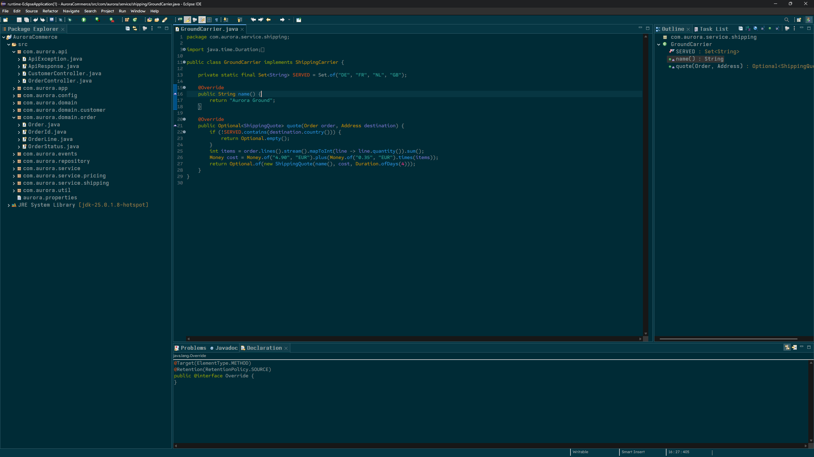
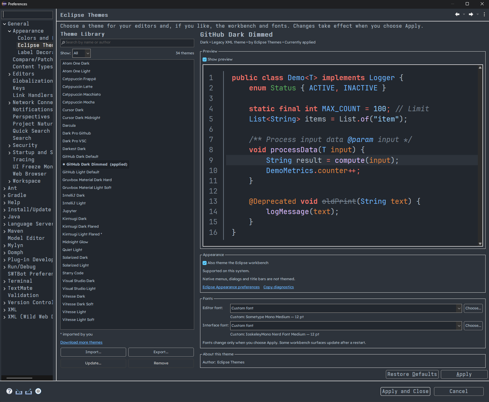
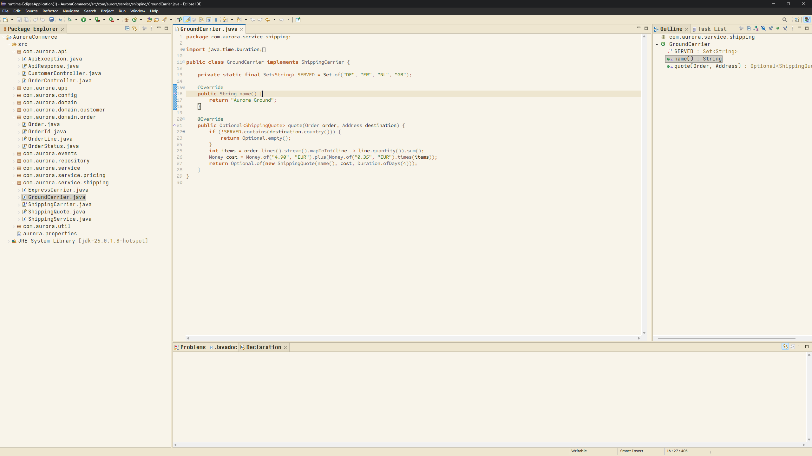

# Eclipse Color Theme

[](https://github.com/ahatem/eclipse-themes-plugin/actions)
[](LICENSE)

**One theme. One coherent Eclipse.**

Choose a color theme once and carry it through Eclipse: your **editors**, optionally the **workbench** around them (window, tabs,
tool bars, trees, tables, status line) and, if you want, the **fonts** too. Themes come from a bundled library, from the
[online collection](https://eclipse-color-themes.vercel.app/), or from your own files.



*Coordinated editor, workbench and typography.*

## Key capabilities

- **Editor themes** for Java, C++, XML and more, with a library of 33 bundled themes and hundreds more online.
- **Coordinated workbench theming** (optional): the same palette on the window, tabs, tool bars, trees, tables and status line.
- **Two fonts, one place**: an **Editor font** and an **Interface font**, each *Keep current*, *Use theme* or *Custom*.
- **Theme packages** (`.ectheme`): a declarative single-file format with author and license details, workbench colors and font
  recommendations, plus **import and export**.
- **Safe by design**: everything the plugin changes is tracked and handed back when you turn it off, and your own later changes
  are never overwritten behind your back.



*One place to choose themes, workbench appearance and fonts.*

## Features

### Themes

- **Searchable Theme Library** with a live preview, filters and the selected theme's details (author, license, source).
- **33 bundled themes**, for example Catppuccin, GitHub, Atom One, Solarized, Gruvbox Material, Vitesse and IntelliJ-style
  themes. Many are ports of well-known color schemes by their original designers; this project does not claim to have designed
  them. Hundreds more are available from the [online collection](https://eclipse-color-themes.vercel.app/).
- **Legacy XML compatibility.** Existing Eclipse Color Theme `.xml` files keep working, and all bundled themes are covered by
  compatibility tests.

### Workbench

Tick **Also theme the Eclipse workbench** to color the window, tabs, tool bars, trees, tables and status line from the selected
theme. It is off by default, it never changes the workbench for a theme you only import, and un-ticking it hands the workbench
back to the theme you had before.

### Fonts

- **Editor font**: editors, consoles and supported code and text views.
- **Interface font**: dialogs, views, trees, tables and supported Eclipse chrome.

Each is **Keep current font** (the default, which leaves the font alone), **Use theme font** (the font the theme recommends) or
**Custom font** (any installed font, chosen with the standard system font dialog). Custom fonts are your own preference: they are
remembered across theme changes and are never written into exported packages.

The result is stored in Eclipse's real font settings, so it appears under *Preferences > General > Appearance > Colors and
Fonts*, and you can still adjust any single font there. Behind each choice is a small, documented set of Eclipse font definitions
(for example the Java editor and console fonts for the Editor font; dialogs, view tabs, trees and tables for the Interface
font), never every font in the IDE. See [font coordination](docs/WORKBENCH_THEMING_COMPATIBILITY.md#font-coordination-why-each-definition-is-included).



*Dark or light — the same coordinated model.*

## Installation

Eclipse Color Theme runs on Java 17 and later.

1. Go to `Help -> Install New Software...`.
2. Click **Add...** and enter the URL: `https://ahatem.github.io/eclipse-themes-plugin/`
3. Give it a name (like `Eclipse Themes`) and complete the installation.

## Using the Theme Manager

Open `Window -> Preferences` (or `Eclipse -> Settings...` on macOS), then `General -> Appearance -> Eclipse Themes`.

1. Search or browse the **Theme Library** on the left and select a theme to see its preview and details on the right.
2. Choose whether to theme the workbench and which fonts to use.
3. Click **Apply** or **Apply and Close**.

Selecting a theme, changing the font options and ticking the workbench option only stage your choices. They take effect when you
choose Apply or Apply and Close, and **Cancel** discards them. **Import**, **Export**, **Update** and **Remove** act on the theme
library straight away and are separate from Apply.

**Restore Defaults** asks how to reset: apply the default theme (workbench theming off, both fonts back to *Keep current
font*), or stop Eclipse Themes management entirely. Either way, fonts the plugin replaced are given back unless you changed them
since.

### If you change a font yourself

Fonts the plugin has set are tracked one by one. If you later change one of them under *Colors and Fonts*, the plugin leaves your
choice alone. Choosing **Apply** on the Eclipse Themes page again is an explicit request: it sets the font group again and says how
many of your own changes it replaced. Setting a font back to *Keep current font* gives back what was there before.

## Theme packages

A theme package is a single `.ectheme` file: declarative XML with the editor colors, optional workbench colors, optional author
and license details and optional font recommendations. It never contains code, CSS or font files.

```xml
<fonts>
  <editor family="JetBrains Mono" size="11"/>
  <interface family="Segoe UI" size="9"/>
</fonts>
```

The full format is described in the [theme package format](docs/THEME_PACKAGE_FORMAT.md).

### Importing and exporting

**Import...** accepts `.ectheme` and `.xml` files; the format is chosen by the file extension. **Export...** saves the selected
theme as a new `.ectheme` file. For a legacy theme this is an explicit conversion into a new file that you choose, and the
installed theme is not changed; a conversion never invents fonts or workbench colors the theme does not state. **Update...**
replaces an imported theme with a file of the same format and **Remove** deletes it after confirmation.

## Compatibility

- Editor themes use the Eclipse editors' own preferences and work wherever the supported editors do.
- Workbench theming and fonts are **verified on Windows with Eclipse 4.40 and 4.41**. Other operating systems and Eclipse
  versions are **experimental** and need an explicit opt-in on the page; Linux and macOS have not been verified.
- The workbench is themed through Eclipse's own theme engine, so high-contrast and accessibility settings are left alone.

See [workbench theming compatibility](docs/WORKBENCH_THEMING_COMPATIBILITY.md) for the coverage, the support matrix and side
effects (four extra entries on the Appearance page).

## Known limitations

- Native menus, dialogs, title bars, Browser content, custom-drawn third-party widgets and icons are not themed by Eclipse CSS and
  may keep their usual look.
- Fonts are family and size only. They are never embedded or downloaded, and a font that a CSS theme itself overrides cannot be
  changed from here. Fonts from third-party plug-ins are coordinated only where Eclipse declares that they follow the Text Font or
  the Dialog Font.
- Some workbench surfaces pick up a changed font only after restarting Eclipse.
- Previews exist only for themes from the online collection; imported packages show no preview.
- Not included: icon theming, CSS authoring or import, a theme marketplace or remote repository.

## Theme authoring

Write a [theme package](docs/THEME_PACKAGE_FORMAT.md) (or export an existing theme and edit it), then import it from the Theme
Manager. Legacy XML themes are described by the Eclipse Color Theme format and work as before:

- Theme XML must not contain a `DOCTYPE`, even an empty or internal-only declaration. Themes that rely on DTD defaults or custom
  entities must be flattened into ordinary XML first. Predefined XML escapes (such as `&amp;`) and numeric character references
  remain supported.
- The parser blocks external entities, DTDs, schemas and XInclude retrieval. If the Java/Eclipse XML provider cannot establish and
  verify these controls, loading fails with a parsing error; there is no insecure opt-out.
- Import always creates an independent installed record. A file whose name, display name, source ID or content matches an
  existing theme never overwrites it; same-named themes coexist. Imported bytes are validated before anything is committed.
- A document whose root is not `colorTheme`, or whose `name` is missing or blank, is refused and nothing is changed. Everything
  else is reported as a warning and the theme is still admitted.

See [editor mapping compatibility](docs/EDITOR_MAPPING_COMPATIBILITY.md) for distinct roles, alias precedence, sparse JDT
semantics, source-hover defaults and the limits of recovery for historical debug indication values.

## Development and contributing

Contributions are welcome; the best way to help is to add a theme to the collection. Please read the
[Contributing Guidelines](CONTRIBUTING.md). The project is a Maven/Tycho build (`mvn clean verify -B`, JDK 21); the runtime
bundle targets Java 17. See the [release notes](docs/RELEASE_NOTES_1.2.0.md) for what is new.

This project began when the original `eclipsecolorthemes.org` website went offline;
[eclipse-color-themes.vercel.app](https://eclipse-color-themes.vercel.app/) is an open-source alternative for finding themes.

[](https://www.buymeacoffee.com/ahmedhatem)

## License and acknowledgements

Licensed under the **Eclipse Public License 2.0**; see [LICENSE](LICENSE).

- This project wouldn't exist without the original [Eclipse Color Theme](https://github.com/eclipse-color-theme/eclipse-color-theme) plugin.
- I also learned a lot from the clean architecture of the [BetterThemes](https://github.com/TheKodeToad/BetterThemes/) project by TheKodeToad.
- Thank you to everyone who has created and shared a theme with the community.
